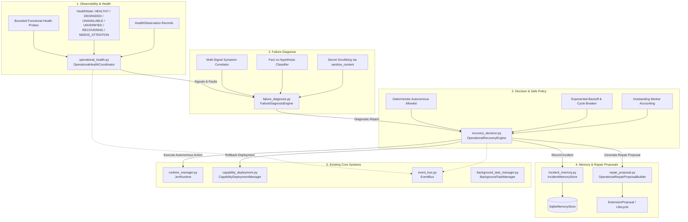

# Phase 26 Architecture Gap Analysis: Adaptive Operations, Failure Diagnosis and Safe Autonomous Maintenance

## 1. Executive Summary

Phase 26 builds upon Hey Jev's existing runtime, recovery, capability deployment, and workflow execution foundations to provide:
- **Unified Operational Health Monitoring**: Continuous, observable health tracking across runtime components, background tasks, native watchers, and deployed capabilities.
- **Evidence-Based Failure Diagnosis**: Systematic correlation of errors, symptoms, dependency states, resource metrics, and version changes, distinguishing empirical facts from working hypotheses without secret leakage.
- **Governed Autonomous Maintenance**: Deterministically policy-bounded corrective actions (`NO_ACTION`, `RETRY`, `RECONCILE_STATE`, `RESTART_COMPONENT`, `ROLLBACK_DEPLOYMENT`, `PROPOSE_REPAIR`, `REQUEST_APPROVAL`, `ESCALATE_TO_USER`) enforced through an immutable low-risk allowlist where LLM recommendations can never override policy constraints.
- **Persistent Incident Memory & Structured Repair Proposals**: Durable tracking of incidents in SQLite memory with automatic secret scrubbing and generation of reviewable extension proposals for code/config/dependency repairs.

---

## 2. Inventory of Existing Mechanisms

The Hey Jev codebase possesses substantial reliability and lifecycle infrastructure across earlier phases:

| Component | Source File(s) | Existing Capabilities |
| :--- | :--- | :--- |
| **Runtime Coordination** | `runtime_manager.py`, `event_bus.py` | Central startup/shutdown coordination, EventBus publish-subscribe event routing, project scanning, component lifecycle orchestration. |
| **Recovery Infrastructure** | `recovery_manager.py`, `recovery_engine.py`, `reliability_model.py` | Task startup reconciliation (`reconcile_startup_tasks`), watcher health checks & restarts, `FailureClassifierV2` (21 categories), `RecoveryDecisionEngine` (RETRY, RESTART, RECONCILE, FALLBACK, COMPENSATE, ROLLBACK, REPLAN, ESCALATE, ABORT), and `CircuitBreakerManager`. |
| **Proactive Heartbeat** | `proactive_heartbeat.py` | Periodic signal polling (`SystemResourceSignalProvider`, `ProjectHealthSignalProvider`, `TaskFailureSignalProvider`, `StaleCacheSignalProvider`), bounded decision engine (`DO_NOTHING`, `NOTIFY_USER`, `PREPARE_RECOMMENDATION`, `PROPOSE_TASK`, `EXECUTE_LOW_RISK`), and strict low-risk allowlist (`prune_temp_cache`). |
| **Background Tasks** | `background_task_manager.py`, `task_storage.py` | Durable SQLite WAL task storage, task status state machine, worker threads, cancellation flags, and timeout handling. |
| **Capability Deployment** | `capability_deployment.py`, `deployment_manifest.py` | Manifest immutability, transactional 2-phase activation with snapshots, in-flight operation tracking & draining, bounded health check probes with timeout & cooperative cancellation, and restart crash recovery. |
| **Workflow Engine** | `workflow_engine.py` | Multi-step capability workflows (`MANUAL`, `COPILOT`, `AUTOPILOT`), resource gating, data interpolation, step-level rollback, and observable outcome verification. |
| **Persistent Memory** | `memory_store.py`, `memory_model.py`, `context_builder.py` | SQLite WAL memory repository, semantic & structured queries, least-privilege sensitivity filtering, and regex-based secret scrubbing (`sanitize_content`). |
| **Extension Proposals** | `extension_proposal.py`, `extension_builder.py`, `staged_runtime.py` | Immutable candidate hashing, multi-stage lifecycle state machine (`DETECTED` $\to$ `ACTIVE`), fail-closed isolation checks, and reviewable proposal data structures. |

---

## 3. Concrete Gaps and Limitations Identified Before Phase 26

Despite the existing components, several architectural gaps exist that prevent fully autonomous, adaptive, and safe operational maintenance:

### 3.1. Unified Operational Health Model Gap
- **Lack of Standard Health States**: Existing systems use boolean flags (`is_healthy: bool`) or disparate statuses (`ToolHealth.OK`, `TaskStatus.FAILED`, `DeploymentStatus.ACTIVE`). There is no unified operational health model covering all subsystem categories (Runtime components, Background tasks, Watchers, Deployed capabilities) with canonical states:
  - `HEALTHY`: Fully functional and responsive.
  - `DEGRADED`: Partially degraded or experiencing transient faults; operational with reduced confidence or performance.
  - `UNAVAILABLE`: Completely down, unresponsive, or failed functional probes.
  - `UNVERIFIED`: Registered or started, but functional health check has not yet confirmed operation.
  - `RECOVERING`: Undergoing active automated recovery, draining, or restart.
  - `NEEDS_ATTENTION`: Requires administrative or human intervention; autonomous recovery exhausted or disallowed.
- **Registration vs. Functional Health**: Previous checks often assumed that if a component was registered in a dict or table, it was healthy. Observable, bounded functional verification with side-effect awareness was not centralized.
- **Observation Richness**: No standardized `HealthObservation` record carrying source identity, failure classification, supporting evidence, confidence score, failure count, outstanding worker count, and recommended action.

### 3.2. Evidence-Based Failure Diagnosis Gap
- **Lack of Symptom Correlation**: Failures in background tasks, native watchers, external providers, or capability handlers were diagnosed in isolation. No correlation engine linked:
  - Task execution errors & stack traces
  - `FailureClassifierV2` error categories
  - Repeated failure frequencies and patterns
  - Dependency availability (missing packages, unreachable sockets)
  - Deployment version activations or changes
  - System resource pressure (RAM/CPU spikes)
- **Fact vs. Hypothesis Conflation**: No distinction existed between verified empirical causes (e.g., missing DLL, port collision, 401 unauthorized) and plausible hypotheses (e.g., transient network hiccup, rate limit backoff).
- **Secret Scrubbing in Diagnostic Data**: Diagnostic traces and log snippets could inadvertently capture tokens, API keys, or personal paths unless systematically scrubbed through `sanitize_content`.

### 3.3. Recovery Decision & Autonomous Maintenance Policy Gap
- **Disparate Action Taxonomies**: `recovery_engine.py` supported one set of strategies, `proactive_heartbeat.py` supported another. Phase 26 requires a unified operational recovery action taxonomy:
  - `NO_ACTION`: Transient or self-resolving; monitor only.
  - `RETRY`: Re-execute with exponential backoff.
  - `RECONCILE_STATE`: Re-align in-memory caches with authoritative SQLite/disk state.
  - `RESTART_COMPONENT`: Safely restart a stateless component or watcher.
  - `ROLLBACK_DEPLOYMENT`: Revert an unhealthy deployed capability to its prior stable release.
  - `PROPOSE_REPAIR`: Formulate a structured, reviewable proposal for code, configuration, or dependency fixes.
  - `REQUEST_APPROVAL`: Gate elevated or irreversible operations behind human confirmation.
  - `ESCALATE_TO_USER`: Notify operator of unrecoverable or policy-blocked failures.
- **Deterministic Allowlist Enforcement**: Proactive maintenance in `proactive_heartbeat.py` was limited to `prune_temp_cache`. Autonomous recovery must safely permit bounded low-risk operations (e.g., authoritative in-memory state reconciliation, bounded probe retries, stateless watcher restart) while strictly prohibiting high-risk operations (e.g., source file modification, credential resetting, privilege changes) without human approval. Crucially, LLM output must **never** override this deterministic policy.
- **Anti-Looping & Cycle Protection**: No global mechanism prevented infinite retry/restart loops across different subsystems when encountering recurring underlying faults.

### 3.4. Capability Deployment Health & Recovery Integration Gap
- Deployed capabilities that fail repeatedly or encounter missing dependencies could remain registered as `ACTIVE` until manually inspected.
- Capabilities need to transition cleanly to `DEGRADED` or `UNAVAILABLE` without silently unregistering or altering security permissions, while delegating verified rollback to `CapabilityDeploymentManager`.

### 3.5. Worker Safety and Outstanding Worker Accounting Gap
- As established in Phase 25.1, Python threads cannot be asynchronously terminated at the OS boundary.
- When an operation times out from the caller's perspective, the underlying worker thread may continue executing until it reaches a cooperative checkpoint or finishes.
- The health coordinator and recovery engine must explicitly distinguish between **caller timeout** and **worker termination**, accounting for outstanding workers and enforcing bounds on active concurrent probe/recovery workers.

### 3.6. Persistent Incident Memory & Reviewable Repair Proposals Gap
- Operational incidents were logged transiently to console or stdout, without structured, durable records in `SqliteMemoryStore`.
- When an incident was caused by a code bug, missing dependency, or configuration mismatch, Jev had no mechanism to formulate a reviewable repair proposal linked to the `ExtensionProposal` lifecycle—risking ad-hoc or unverified modifications to production code.

---

## 4. Target Architecture for Phase 26

To resolve these gaps cleanly without duplicate architectures, Phase 26 introduces the following cohesive module structure:

---

## 5. Implementation Roadmap

1. **`operational_health.py`**: Canonical `HealthState`, `HealthObservation`, component health probes, outstanding worker tracking, and `OperationalHealthCoordinator`.
2. **`failure_diagnosis.py`**: Symptom extraction, dependency/resource correlation, hypothesis generation, and evidence-grounded `DiagnosticReport`.
3. **`recovery_decision.py`**: Phase 26 action taxonomy, deterministic autonomous allowlist enforcement, backoff/loop protection, and recovery execution.
4. **`incident_memory.py` & `repair_proposal.py`**: Structured incident logging in SQLite with secret redaction, and `ExtensionProposal` generation for code/config repairs.
5. **Runtime Integration**: Wire the health coordinator into `JevRuntime` (`runtime_manager.py`) and connect to EventBus.
6. **Comprehensive Verification**: 20 required test suites in `test_phase26.py`, full regression tests, and preflight audit.
