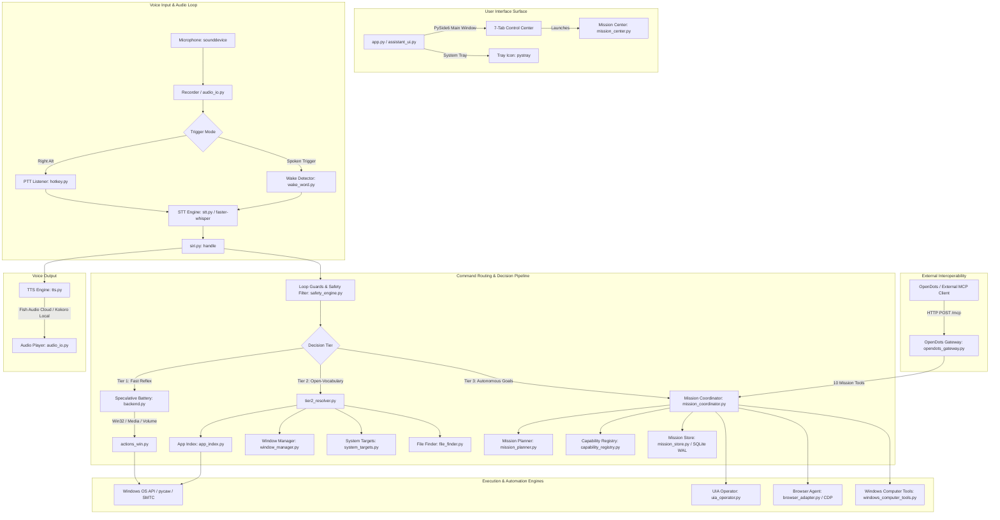

# Hey Jev: System Architecture & Code Map

This document describes the concrete, code-verified architecture of Hey Jev as implemented on branch `windows-port`.

---

## 1. System Overview Diagram



---

## 2. Application Entrypoints

### 2.1 Desktop GUI Entrypoint: `app.py`
- **File:** `app.py`
- **Responsibility:** Main process entry point for desktop operation.
- **Key Calls:**
  - Calls `assistant_ui.run_app()`.
  - Initializes PySide6 application lifecycle (`QApplication`).
  - Spawns background worker thread for the voice assistant (`siri.run_voice_assistant`).
  - Creates the system tray icon (`pystray`) and handles minimize-to-tray.

### 2.2 Voice Assistant Daemon / CLI: `siri.py`
- **File:** `siri.py`
- **Responsibility:** Core voice loop, hotkey management, wake detection, turn state machine, and audio playback.
- **Key Functions:**
  - `run_voice_assistant(notify, controls, mode, mic, wake_backend, wake_model)`: Main background thread loop.
  - `handle(text, stt_ms, notify, quiet)`: Dispatches recognized text through guards, safety engine, Tier 1, Tier 2, and Tier 3.
  - `run_turn(text, stt_ms, quiet)`: Executes the resolved action or triggers clarification.
  - `say(line, notify)`: Triggers text-to-speech feedback.

### 2.3 Desktop GUI Architecture: `assistant_ui.py`
- **File:** `assistant_ui.py`
- **Responsibility:** Native PySide6 interface presenting 7 functional tabs:
  1. `StatusTab`: Visual waveform animation, listening state, and recent activity log.
  2. `MemoryTab`: User semantic memory list and recall test tools (`memory_controller.py`).
  3. `ProjectsTab`: Registered developer directories and workspace health (`project_registry.py`).
  4. `TasksTab`: Scheduled background tasks and system watchers (`scheduler_backend.py`).
  5. `SwarmsTab`: Multi-agent swarm coordination logs (`swarm_engine.py`).
  6. `MissionsTab`: Overview of autonomous missions and launcher for `MissionCenterWindow`.
  7. `KeysTab`: Configuration of API keys, hotkeys, and model backends.

### 2.4 Mission Center Window: `mission_center.py`
- **File:** `mission_center.py`
- **Responsibility:** Standalone or embedded PySide6 window for deep mission inspection and human control.
- **Key Features:**
  - Mission list selector with status badges (Pending, Planning, Approved, Running, Completed, Failed, Paused).
  - Graph canvas displaying task dependencies (DAG) with color-coded nodes.
  - Acceptance criteria checklist showing verification evidence.
  - Control action bar: **Approve**, **Pause**, **Resume**, **Cancel**, **New Mission**, and **Refresh**.
  - Live progress calculation via `mission_ui_signals.py` (`calculate_mission_progress`).

### 2.5 OpenDots Interoperability Gateway: `opendots_gateway.py`
- **File:** `opendots_gateway.py`
- **Responsibility:** Standalone loopback HTTP server implementing Model Context Protocol (MCP) Streamable HTTP transport (Protocol version `2025-03-26`).
- **Network Boundaries:** Binds strictly to `127.0.0.1` (configurable via `JEV_OPENDOTS_HOST`).
- **Security:** Requires HTTP header `Authorization: Bearer <token>` (configured via `JEV_OPENDOTS_BEARER_TOKEN`).
- **Exposed Tools:**
  1. `list_missions`
  2. `get_mission`
  3. `create_mission`
  4. `plan_mission`
  5. `approve_mission`
  6. `execute_mission`
  7. `pause_mission`
  8. `resume_mission`
  9. `cancel_mission`
  10. `get_capabilities`

---

## 3. Voice Input & Speech Pipeline

```
Microphone Audio -> audio_io.Recorder -> VAD / Silence Trimming -> STT Engine -> Transcript
```

### 3.1 Audio Ingestion: `audio_io.py`
- Uses `sounddevice` to capture 16kHz 16-bit mono float32 audio buffers.
- Maintains silence detection and settling logic (`is_audio_playing_or_settling()`) to prevent the microphone from recording assistant speech (acoustic feedback loop prevention).

### 3.2 Speech-to-Text: `stt.py`
- Default engine: `faster-whisper` running model `small.en` on CPU using `int8` quantization and 2 CPU threads. (This doc previously said `tiny.en`; `config.WHISPER_MODEL` and `stt.py` both ship `small.en`. B5 — the documented model was never the running one.)
- `transcribe_audio(audio, prompt, drop_noise)`:
  - Injects `INITIAL_PROMPT` containing common Windows application names and technical terms to guide Whisper's language decoder.
  - Supports hotword biasing (`HEYJEV_STT_HOTWORDS`).
  - Strips noise tokens and hallucinated repetitions.

### 3.3 Wake-Word Detection: `wake_word.py`
- Supports two wake detection backends:
  - `openWakeWord`: Local neural model running on ONNX (`openwakeword>=0.6.0`).
  - Gated Whisper VAD: Short-audio silence-gated transcription looking for regex `\b(?:hey\s+)?jev\b`.

### 3.4 Speech Synthesis (TTS): `tts.py`
- Primary provider: Fish Audio cloud API (`fish.audio`) producing natural speech.
- Cache layer: Synthesized audio chunks are cached on disk at `%LOCALAPPDATA%\HeyJev\tts_cache` using MD5 hashes of prompt text.
- Offline fallback: `kokoro_tts.py` using local Kokoro ONNX model when cloud API keys are unavailable.

---

## 4. Command Routing & Execution Pipeline

When a spoken or text command arrives in `siri.py:handle`, it passes through sequential evaluation gates:

### Step 1: Pre-Execution Safety & Loop Guards
- **Transcript Dedup Guard (Guard b):** Drops identical transcripts arriving within 5.0 seconds (`check_and_update_transcript_dedup`).
- **Reply Echo Guard (Guard d):** Drops transcripts that match the assistant's own recent spoken output (`is_matching_recent_reply`).
- **Emergency Interrupts:** Spoken phrases `"stop"`, `"cancel"`, `"hold on"`, `"wait"` immediately cancel pending operations via `safety_engine.request_global_cancel`.
- **Undo Hook:** Spoken `"undo"` triggers `safety_engine.perform_undo()`.
- **Pending Confirmation Response:** If the assistant is waiting for confirmation, user replies (`"yes"`, `"no"`, `"proceed"`) are directed to `ConfirmationManager`.

### Step 2: Direct Tier 2 Routing (`is_tier2_direct_match`)
- Evaluates whether the request is an open-vocabulary application command, window management, or system target outside the hardcoded Tier 1 battery.
- If true, bypasses Tier 1 remote LLM calls directly to avoid unnecessary latency and cost.

### Step 3: Tier 1 Speculative Decision Battery
- Dispatches questions to `DecisionBackend` (`backend.py`):
  - `JevBackend`: Remote TypeSafe API (`api.typesafe.ai`) evaluating speculative intent questions in a single batched HTTP request.
  - Evaluates: `category`, `compound`, `target`, `app`, `app_action`, `browser_action`, `volume_action`, `volume_scope`, `volume_level`, `display_action`, `media_action`, `timer_action`, `system_action`.
- Returns categorized action payload.

### Step 4: Tier 2 Local Resolvers (`tier2_resolver.py`)
- Invoked when Tier 1 returns `app: none`, `clarify`, or unhandled targets:
  - `app_index.py`: Searches Windows Start Menu, Program Files, and `shell:AppsFolder` for matching applications. Applies fuzzy matching (RapidFuzz) and phonetic matching.
  - `system_targets.py`: Maps phrases to `ms-settings:` URIs, standard user folders (Downloads, Documents), or system utilities (Task Manager, Control Panel).
  - `window_manager.py`: Parses and executes window positioning (`snap left`, `snap right`, `maximize`, `minimize`, `restore`).
  - `file_finder.py`: Queries Windows Search Index for local documents.

### Step 5: Tier 3 Tool-Calling Agent (`tier3_agent.py`)
- Invoked for complex reasoning when `tier3_enabled` is set in preferences.
- Uses `windows_computer_tools.py` to interact with the desktop.

---

## 5. Autonomous Mission Subsystem (System 3)

The persistent mission subsystem enables long-running, multi-step goal execution:

```
Goal String -> MissionCoordinator.create_mission -> DeterministicMissionPlanner -> Mission DAG
                                                                                        |
Execution Loop <- Human Approval <- Capability Discovery <- Dependency Resolution <----+
       |
SQLite WAL Store (Persistence & Recovery across Restarts)
```

### 5.1 Domain Model: `mission_model.py`
- `Mission`: High-level goal, status (`PENDING`, `PLANNING`, `APPROVED`, `RUNNING`, `COMPLETED`, `FAILED`, `PAUSED`, `CANCELLED`), task list, acceptance criteria, checkpoints, and budget limits.
- `MissionTask`: Individual execution unit with dependency IDs (`depends_on`), assigned agent/capability, input parameters, and status (`PENDING`, `RUNNING`, `COMPLETED`, `FAILED`, `BLOCKED`, `SKIPPED`).
- `AcceptanceCriterion`: Verifiable outcome contract with verification query, status (`PENDING`, `SATISFIED`, `FAILED`), and evidence payload.

### 5.2 Persistence Layer: `mission_store.py`
- Authoritative storage in SQLite WAL mode: `%APPDATA%\hey-jev\hey_jev_missions.db`.
- Supports transactional state updates, task status transitions, execution events, and full mission recovery on application reboot.

### 5.3 Deterministic Mission Planner: `mission_planner.py`
- Decomposes high-level natural language goals into topological DAGs without hallucinations.
- Matches required task capabilities against `CapabilityRegistry`.
- Synthesizes concrete acceptance criteria for every mission.

### 5.4 Mission Coordinator: `mission_coordinator.py`
- Coordinates task execution in dependency order.
- Enforces human approval checkpoints: pauses execution and requests confirmation before high-risk or external operations.
- Automatically handles task retry, failure classification, and adaptive replanning.

---

## 6. Windows Desktop Automation Engines

Hey Jev automates Windows using three complementary layers:

### 6.1 Win32 Actions: `actions_win.py`
- Implements 33 discrete Windows desktop actions.
- Dispatched via non-blocking thread pool (`_ACTION_EXECUTOR = ThreadPoolExecutor(max_workers=4)`).
- Media controls: WinRT `GlobalSystemMediaTransportControlsSessionManager` (SMTC) with `SendInput` (`VK_MEDIA_*`) fallback.
- Audio volume: Direct Windows endpoint control via `pycaw`.
- Registry operations: Windows 10/11 Dark/Light theme toggling with `WM_SETTINGCHANGE` broadcast.
- Process control: Graceful `WM_CLOSE`, followed by 1.5s timeout, and force-kill process-tree termination via `psutil`.

### 6.2 Computer Operator 2.0 (UI Automation): `uia_operator.py`
- High-level accessibility-driven desktop automation via `pywinauto` (UIA backend).
- Inspects control trees, finds buttons/inputs by name, control type, or AutomationID.
- DPI-aware coordinate mapping (`dpi_manager.py`).

### 6.3 Browser Agent (CDP): `browser_adapter.py` & `browser_session.py`
- Controls Chrome and Microsoft Edge via Chrome DevTools Protocol on port `9555`.
- Spawns isolated user profiles in `%TEMP%\HeyJev\browser_sandbox` to protect user browser data.
- Executes Observe-Act-Verify loops for web navigation and form filling.

---

## 7. Safety, Reliability & Audit Subsystems

### 7.1 Safety Engine: `safety_engine.py`
- Categorizes actions into five risk tiers: `SAFE`, `LOW`, `MEDIUM`, `HIGH`, `CRITICAL`.
- Hard-coded denylist prevents catastrophic commands (e.g., recursive directory deletion, disk formatting, registry deletion).
- Interactive `ConfirmationManager` halts execution until user confirms high-risk actions.
- Automatically redacts API keys and sensitive strings from logs (`redact_secrets`).
- Appends every executed action to the audit ledger: `%APPDATA%\HeyJev\actions.jsonl`.

### 7.2 Undo Manager: `undo_manager.py`
- Maintains an in-memory and disk-backed undo stack for reversible desktop actions.

### 7.3 State Checkpoints & Recovery: `reliability_manager.py`
- Persists state checkpoints with calculated SHA-256 checksums.
- Automatically validates database integrity and restores checkpoints upon corrupted restarts.

---

## 8. Data Storage & Application Data Locations

All persistent application data resides strictly in the user's roaming AppData:

```
%APPDATA%\HeyJev\
├── Hey Jev.log               # Rotating debug and activity log
├── actions.jsonl             # Append-only security audit ledger
├── settings.json             # User preferences and model settings
├── vocabulary.json           # Phonetic vocabulary corrections
├── apps.json                 # Custom application aliases
├── memory.db                 # Semantic memory store (SQLite WAL)
├── projects.db               # Registered code projects (SQLite WAL)
├── background_tasks.db       # Scheduled background tasks (SQLite WAL)
└── heyjev_swarms.db          # Multi-agent swarm state (SQLite WAL)

%APPDATA%\hey-jev\
└── hey_jev_missions.db       # Authoritative Mission Store (SQLite WAL)

%LOCALAPPDATA%\HeyJev\
└── tts_cache\                # Cached TTS audio files (.wav)
```
